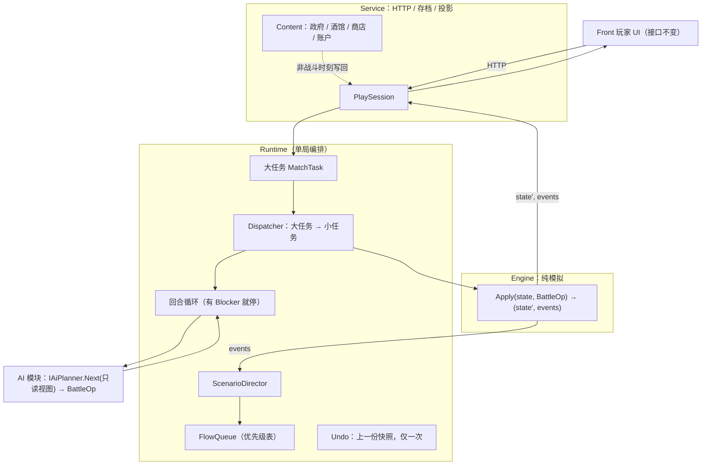

# Engine 重构设计：Engine / Runtime / AI / Flow 分层

状态：**设计定稿，迁移进行中**
关联：[module-responsibilities.md](./module-responsibilities.md)、[interface-contracts.md](./interface-contracts.md)、[operations.md](./operations.md)。

---

## 1. 目标

Engine 只做战场模拟。调度、AI、剧情流程、信息框阻塞、账户操作全部移出 Engine。前端接口（`/api/play/action` 的 `op`、状态里的 `dialogue` / `scenarioPopup` 等字段）**保持不变**。

## 2. 总览



## 3. 职责

| 层 | 职责 | 明确不做 |
|---|---|---|
| **Engine** | 执行最原始的战场小任务（Move、Attack、EndTurn、Train 等）；`Apply` 返回新状态与 `events`（实际发生了什么：路径、伤害、暴击、触发的剧情事件 id） | 不分发、不含 AI、不校验发起者身份、不持有对白 / 剧情流程、不碰账户 |
| **Runtime（单局编排）** | 大任务拆小任务；回合循环；持有 FlowQueue 与 Undo 快照；入口处校验阶段与 Blocker | 不做战场规则计算 |
| **AI** | 读只读视图，产出 `BattleOp`；从 Engine 抽出 | 不能产生流程类任务；没有特权通道 |
| **ScenarioDirector** | 依据 events 触发剧情并入队 FlowItem；把选择结果展开成小任务 | |
| **Service** | HTTP、存档、把状态投影成现有前端字段 | 不再自行判断 `PendingDialogue` |
| **Content** | 政府上将、酒馆、商店、账户花费 | 不进 Engine |

> 命名：原 `Ew4.Platform.Runtime` 已更名为 `Ew4.Platform.Play`（内容绑定与分派部分移到 Service）；单局编排落在其 `Match/` 命名空间下，不新开程序集。AI 抽到独立程序集 `Ew4.Platform.Ai`（引用 Engine，Engine 不引用 Ai）。

## 4. 大任务与小任务

界面任务**不必**与 Engine 任务一一对应。

| 大任务（界面 op） | 小任务（Engine） |
|---|---|
| `move` / `attack` / `train` / `upgrade` / … | 同名 BattleOp，一对一 |
| `end` | `EndTurn`，随后 Runtime 回合循环调用 AI，产生若干 BattleOp |
| `ai` | 回合循环的一步：`Planner.Next` → BattleOp |
| `dialogue` | **无**；Runtime 弹出 FlowQueue 队首 |
| `event_choice` | Director 把选择结果展开成若干小任务（或整体状态变换） |
| `undo` | **无**；Runtime 还原上一份快照 |
| `use_item` / `deploy` / `hire` | **不进 Engine**：Content 处理账户，Service 在非战斗时刻写回 Session |

### 示例：结束回合触发剧情

| 步骤 | 动作 | Engine 小任务 |
|---|---|---|
| 1 | 玩家 `end` | `EndTurn` |
| 2 | 回合循环：Blocker 为空 | |
| 3 | `Planner.Next` | `Move`（AI） |
| 4 | Apply 返回 `events=[Moved, ScenarioTriggered(e1)]` | |
| 5 | Director 把 e1 变成 FlowItem 组入队 | 无 |
| 6 | 回合循环发现队首存在，停止，视图返回前端 | |
| 7 | 玩家 `dialogue` | **无** |
| 8 | 玩家 `event_choice` | 选择结果展开的效果 |
| 9 | 队列清空，循环继续 | |

## 5. Blocker 与 FlowQueue

Blocker 是 Runtime 的 FlowQueue 队首，**不是** Engine 状态。FlowQueue 是**单局状态**：只影响本局，随单局存档保存，不触碰账户等全局数据。

```csharp
enum FlowKind
{
    GameOver = 0,        // 终局，压过一切，不可解除
    ScenarioPopup = 10,  // 剧情弹窗，可带分支
    Dialogue = 20,       // 普通对白
}
```

`FlowItem`：`Kind`、`Id`、`Payload`、`Resolution`（`Ack` / `Choice` / `None`）、`Group`（事件 id）、`Seq`。

排序：**组间**按 `Kind` 优先级，**组内**严格保持剧本顺序，同级按 `Seq`。

防死锁不变量：

1. 每个 FlowItem 必须有且仅有一种合法解除方式，前端有对应入口；`Resolution=None` 只允许 `GameOver`。
2. 解除操作只匹配队首：`dialogue` 只关队首 `Dialogue`，`event_choice` 只处理队首 `ScenarioPopup`；不匹配则返回明确错误码。
3. 解除一项可以入队新项，但不得依赖其它未解除项。
4. `GameOver` 后不再入队，也不再触发剧情。
5. 同一 `Group` 只能入队一次。
6. 开发期断言：回合循环因队首停住时，必须存在可用的解除操作。

### 前端投影（字段保持不变）

| 队首 | 投影 |
|---|---|
| `ScenarioPopup` | `scenarioPopup`，`dialogue` 为空 |
| `Dialogue` | `dialogue` + `dialoguePresentation`，`scenarioPopup` 为空 |
| `GameOver` | `phase = Finished` |
| 空 | 两字段均空 |

## 6. 其它决定

- **Apply 返回 events**：消除 `PreviewAttack` / `Reachable` 在 Apply 前后的重复计算，保证演出与实际结果一致（战斗含随机）。
- **身份校验不在 Engine**：Human 路径由 Service / Runtime 校验是玩家回合；AI 路径只会发 BattleOp，类型上拿不到流程任务。Engine 只校验规则本身（阶段、单位、revision）。
- **Undo**：Apply 是纯函数，Runtime 保留上一份快照。仅 `Move` 成功后可撤，其它 Op 或触发剧情即清空；只撤一次。
- **剧情选择**：以前端行为一致为准，内部实现不限。迁移期允许 Director 先对状态做整体变换，再逐步收敛成原语。
- **胜负条件**：能仅凭战场状态判断的留在 Engine，通过 events 报告 `Victory`；依赖剧情事件的归 Director。

## 7. 存档影响

单局存档增加：FlowQueue、已触发剧情事件集合。读档后必须能恢复"正在等待确认 / 选择"的状态。

## 8. 迁移步骤

每步均需 `scripts/ew4.sh build` 与 `scripts/ew4.sh test` 通过，并保持前端行为不变。

| # | 步骤 | 验收 |
|---|---|---|
| 0 | 行为基线：补充覆盖现有对白 / 剧情选择 / 结束回合 / AI 回合 / undo 的测试 | 测试绿 |
| 1 | AI 抽出：新建 `Ew4.Platform.Ai`；`IAiPlanner.Next` → BattleOp；删除 `AiStepCommand` 与 Engine 内 AI 目录 | 测试绿；Engine 不含 AI |
| 2 | `Apply` 返回 `events`；Service 去掉重复预览 / 路径推算 | 演出与结果一致 |
| 3 | Runtime `Match`：大任务、Dispatcher、回合循环；`PlaySession` 改为薄层 | `PlaySession` 不含规则判断 |
| 4 | FlowQueue 与优先级表；`PendingDialogue` 迁出 Engine；存档字段 | 前端无需改动 |
| 5 | ScenarioDirector：剧情触发与选择结果 | 剧情快照测试绿 |
| 6 | Undo 迁入 Runtime；账户类 op 从 Engine 命令中移出 | `movementHistory` 删除 |
| 7 | 清理：Engine 残留调度 / 流程代码，更新 `module-responsibilities.md` | 文档与代码一致 |

## 9. 进度

| 项 | 状态 |
|---|---|
| 设计文档 | 已写入 |
| 基线 `scripts/ew4.sh test` | 全绿 |
| `Runtime/Match/FlowQueue` + `FlowKind` 优先级表 + 防死锁测试 | 已完成，已接入 `PlaySession`（经 `MatchFlow`） |
| 步骤 1 AI 抽出 | **已完成**，见 §10 |
| 步骤 2 `Apply` 返回 events | **已完成**，见 §11 |
| 步骤 3–5 Runtime 持有 Flow、对白/剧情选择入队 | **已完成（采用精简方案）**，见 §11 |
| 步骤 6 Undo 单槽 | **已完成**，见 §11 |
| 步骤 7 清理 | 已完成：删除 `MovementHistory`、`ScenarioRules` 弹窗校验；`PlaySession` 不再读 `PendingDialogue` |

## 10. 步骤 1 结果：AI 抽出

- 新程序集 `Ew4.Platform.Ai`（netstandard2.1，只引用 Engine）；Engine 不再含 AI，`RuleSet` 不再含 `Ai` / `Production`。
- 入口 `AiPlanner.Next(world, ruleSet, aiRules, production, random) → AiStep(Commands, RandomState)`。`Commands` 是与玩家完全相同的 `EngineCommand`；执行方逐条改写 `ExpectedRevision` 后经 `Apply` 执行。
- 为统一操作，Engine 新增两个通用命令：`HoldCommand`（单位待命）、`DeployCommanderCommand`（部署将领）；删除 `AiStepCommand`、`IEngine.PlanAiStep` 与全部 `Execute*`。
- AI 的一步映射：生产→`Recruit` / `BuildInstallation` / `UpgradeBuilding` / `BuyTransport`（带搬迁的招募 = `Move` + `Recruit`）；单位→`Attack` / `Move`（+`Attack`）/ `BuyTransport`+`Move` / `Hold`；无事可做→`EndTurn`。
- **方案 B**：`AiRandomState` 从 `WorldState` 移除，由 `PlaySession` 持有并写入单局存档（`PlaySlot.AiRandom`）；旧存档缺该字段时重新取种子。
- `AiPlanner` 以 `RuleSet.Movement` 覆盖 AI 自带的移动规则，删除了 `Ai.Movement` 的重复副本维护。
- 共用的负担能力计算迁到 Engine：`Affordability.Copies`。
- 已知差异：一步 AI 现在可能产生多个 revision（如移动+攻击为 +2，原为 +1）；中途出现对白或终局时后续命令不再执行，行为与原先一致。
- 验证：`scripts/ew4.sh test` 全绿；真实服务上用脚本跑 `campaign1_01`、`campaign1_08`、`conquest1`、`conquest2` 各数个回合（含招募、设施、升级等生产），AI 全程无错误。

## 11. 步骤 2–7 结果

- **events**：`EngineResult.Events`（`UnitMovedEvent` 路径、`AttackResolvedEvent` 预览）由 `Apply` 内按同一规则预先计算；Service 不再自己调用 `Reachable` / `PreviewAttack` 来推演展示。
- **Flow 归 Runtime**：`WorldState` 持久状态不再保存 `PendingDialogue/QueuedDialogues`。`Apply` 返回 `EngineResult.Flow`（`FlowRequest`：对白 / 剧情弹窗）；`Runtime/Match/MatchFlow` 包装 `FlowQueue`，队首即 Blocker，随单局存档（`PlaySlot.Flow`）；旧存档里残留的对白在读档/开局时由 `FlowExtraction.Take` 自动迁入队列。
- **精简取舍**：剧情规则本身（条件/效果/选择）仍留在 Engine 的 `ScenarioRules`，没有拆出独立 Director。规则代码内部仍用 `PendingDialogue` 作为单次 `Apply` 内的临时槽：只有 `DialogueAckCommand` / `EventChoiceCommand` 带入当前队列（`Waiting`），引擎借出后取回，因此行为与原先逐条一致（含最后一条确认后的事件/胜负重评估）。
- **门禁**：队列非空时，Service 对一切战场/账户操作统一返回 `action.dialogue_pending`；结算（`BattleSettlement`）在阻塞期间推迟；AI 在阻塞时暂停。
- **Undo**：`Runtime/Match/UndoSlot` 只记住"最近一次移动之前"的完整局面，且仅在版本号未变时有效（其后任何操作都使其失效）。行为变化：不再支持连续撤销多次移动；撤销状态不入存档。`Service/MovementHistory` 已删除。
- **账户操作**：商店/酒馆/政府仍在 Content/Service，不进 Engine。
- 未使用 `FlowKind.GameOver`：终局展示沿用现有结算机制。
- 顺带修复：`WorldSave` 不再要求已删除的 `aiRandomState`；读档开局时传入当前账号（原先内容修订号不一致导致读档失败）。
- 验证：`scripts/ew4.sh test` 全绿（新增 `MatchFlowTests`）；真机验证：多个战役开局对白（门禁、逐条确认）、对白中途存档再读档、移动后撤销、AI 多回合。

## 12. 未决项

- `WorldVictory` / `ExtensionVictory` 的归属细节。
- 剧情效果能否全部拆成 Engine 原语（允许先整体替换状态过渡）。
