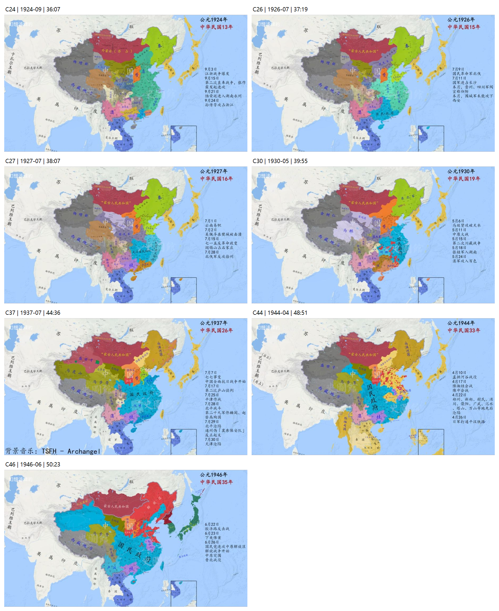

# 《颓垣饿鸠》历史版图视频参考截图

归档日期：2026-10-20。用户指定参考，直接跳转所需时点截图，未从头观看。本轮仅固定资料，没有修改游戏版图、BTL、JURI或导出包。护国战争时间点按用户要求暂时搁置。

来源：[【史图馆】中国历代疆域变化新版合集 近现代篇](https://www.bilibili.com/video/BV1QC8t6rEs2/)，总长58:22。页面显示UP主为幻想浅绿豹，创作团队包含史图馆等。视频简介列有[参考资料文章](https://www.bilibili.com/opus/1239681132505595911)，本轮未打开校核该文章。

截图关闭弹幕，保留视频中的署名、水印、年份和事件栏。JPG为完整播放器截图（920×956），含时间显示；`-map.png`为同一截图中地图区域的无缩放裁剪（左0、上199、宽920、高518）。裁剪不提高视频原始清晰度。文件名时间戳采用播放器显示的整秒时间；不能据此推断逐帧精度。文件尺寸与SHA256见`files.json`。

## 七个开局的参考帧

视频事件栏按月份或阶段集中显示，以下“画面时段”依据实际画面年份与事件日期识别，不能直接当作开局当天的精确实控线。

| 剧本 | 当前开局日期 | 画面时段 | 播放器时间 | 画面事件核对点 | 截图 |
| --- | --- | --- | --- | --- | --- |
| C24 直奉决裂 | 1924-09-15 | 1924年9月 | 36:07 | 9月3日江浙战争、9月15日第二次直奉战争，尚未进入10月北京政变画面 | [地图](C24_1924-09_t36m07s-map.png) · [完整截图](C24_1924-09_t36m07s.jpg) |
| C26 北伐洪流 | 1926-07-09 | 1926年7月 | 37:19 | 7月9日北伐、7月11日进占长沙；当月后续进展不能提前放到9日 | [地图](C26_1926-07_t37m19s-map.png) · [完整截图](C26_1926-07_t37m19s.jpg) |
| C27 宁汉分裂 | 1927-07-01 | 1927年7月 | 38:07 | 7月1日云南易帜、7月15日政变、7月28日徐州；不可把整月结果当作1日现状 | [地图](C27_1927-07_t38m07s-map.png) · [完整截图](C27_1927-07_t38m07s.jpg) |
| C30 中原逐鹿 | 1930-05-01 | 1930年5月 | 39:55 | 5月11日中原大战及其余5月事件；另存4月底参考，避免将月内战果提前 | [地图](C30_1930-05_t39m55s-map.png) · [完整截图](C30_1930-05_t39m55s.jpg) |
| C37 全面抗战 | 1937-07-07 | 1937年7月 | 44:36 | 7月7日事变，也列7月底平津事件；另存6月参考 | [地图](C37_1937-07_t44m36s-map.png) · [完整截图](C37_1937-07_t44m36s.jpg) |
| C44 抗战转折 | 1944-04-01 | 1944年4月 | 48:51 | 4月17日豫湘桂会战、4月下旬陷城与平汉铁路事件；另存3月参考 | [地图](C44_1944-04_t48m51s-map.png) · [完整截图](C44_1944-04_t48m51s.jpg) |
| C46 全面内战 | 1946-06-26 | 1946年6月下旬 | 50:23 | 6月22日、23日事件，以及6月26日进攻中原解放区、中原突围 | [地图](C46_1946-06_t50m23s-map.png) · [完整截图](C46_1946-06_t50m23s.jpg) |

## 必要的前置对照

| 对应剧本 | 画面时段 | 播放器时间 | 用途 | 截图 |
| --- | --- | --- | --- | --- |
| C30 | 1930年4月 | 39:53 | 事件栏至4月30日，供5月1日开局对照；仍需核对画面内变化顺序 | [地图](C30_before_1930-04_t39m53s-map.png) · [完整截图](C30_before_1930-04_t39m53s.jpg) |
| C37 | 1937年6月 | 44:31 | 与7月参考并读，避免采用平津沦陷后的版图作为七七事变开局 | [地图](C37_before_1937-06_t44m31s-map.png) · [完整截图](C37_before_1937-06_t44m31s.jpg) |
| C44 | 1944年3月 | 48:48 | 与4月参考并读，避免采用豫湘桂推进后的结果作为4月1日开局 | [地图](C44_before_1944-03_t48m48s-map.png) · [完整截图](C44_before_1944-03_t48m48s.jpg) |

## 后续使用

先对照日期辨认实际控制、地方派系与争夺区，再映射到游戏地块；国家归属与同盟阵营分开处理。不能仅凭截图颜色认定游戏阵营，也不能把省域整块划给单一势力。细小根据地、县界、铁路控制与殖民据点若分辨不足，标待核对，不凭清晰度不足的截图补画。

历史地块归属核对后，再按用户既定规则分配城市辖区：有实际区划优先采用，缺失部分才在已确定的势力范围内就近分配，最后写入BTL的JURI扩展。现有试制地图仍未验收，本轮截图不等于已完成边界修订。

归档记录：7张主参考、3张前置对照；护国战争暂缓。截图均来自上述用户指定视频，未下载完整视频，未另行搜索其他视频。
